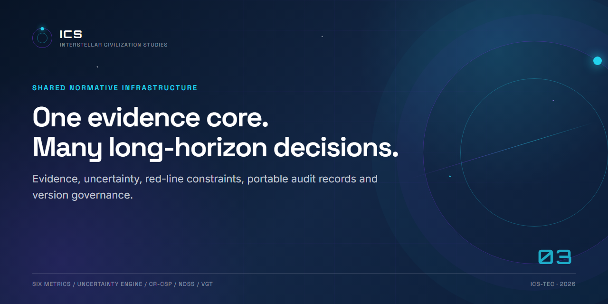

<p align="center">
  
</p>

# CRE-OS

**Open evidence, uncertainty and version governance for long-horizon
decisions.**

CRE-OS is the shared technical core beneath ICS audit and governance products.
It keeps evidence, assessments, uncertainty, red-line checks, decision records
and version history in one reproducible contract.

CRE-OS is infrastructure, not a consumer application or an autonomous ethical
authority.

[English manual](./docs/manual-en.pdf) ·
[Portfolio](https://github.com/ics-studies/ics-portfolio) ·
[ICS website](https://ics-studies.org/en/)

**Product type:** open Python foundation and commercial integration layer.

## Core components

- an evidence gate that fails closed when required evidence is absent;
- six metric contracts: UCS, RFD, CRV, CDI, MBCL and CSIA;
- a risk, Knightian and deep-uncertainty engine;
- the finite-action CR-CSP constraint solver;
- NDSS decision-support reports;
- SSTP scenario and quality checks;
- VGT version history and dependency impact; and
- a shared portable audit record.

Production measurement records source evidence, reviewer, uncertainty, method
version and a SHA-256 audit digest.

## Intended scope

CRE-OS is designed for eleven ICS domains: AI safety, mirror life, space
exploration and commercialization, quantum computing, synthetic biology and gene
editing, brain-computer interfaces, SETI/METI, climate response, nuclear
proliferation, existential risk and international space law.

The common core does not replace domain science, law, professional judgment or
institutional authority.

## Install the local reference

```powershell
python -m venv .venv
.\.venv\Scripts\python.exe -m pip install "https://github.com/ics-studies/cre-os/releases/download/v1.0.1/ics_cre_os-1.0.1-py3-none-any.whl"
ics-cre-os status
```

Build an evidence-gated measurement:

```powershell
ics-cre-os measure --input measurement.json
```

## Product boundary

CRE-OS does not issue legal, safety, regulatory, launch or investment
determinations. The local API is a reference interface, not a production
multi-tenant service. Outputs require context, uncertainty review and qualified
human judgment.

## Licence

Reference code is licensed under Apache License 2.0. Public methods and
interface specifications may use CC BY-SA 4.0 where marked. Enterprise
connectors, hosted operations, certification and customer evidence remain
separately governed.

Copyright 2026 Xue Zhi Xin (ICS-TEC).
